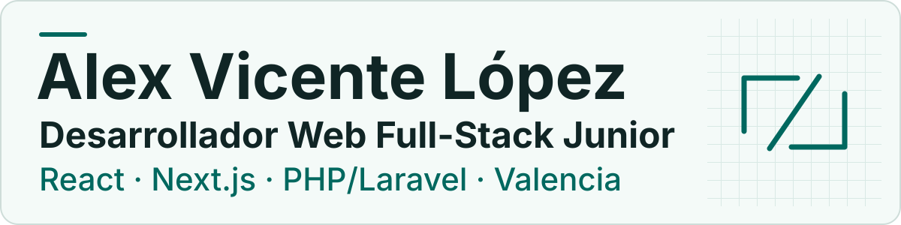
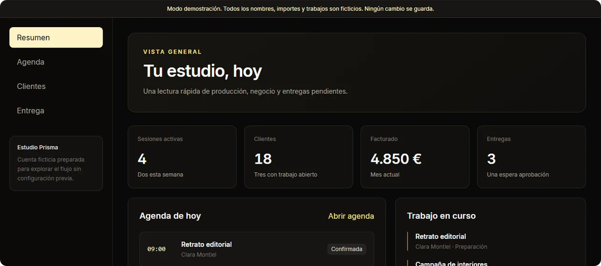
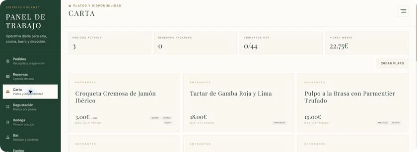
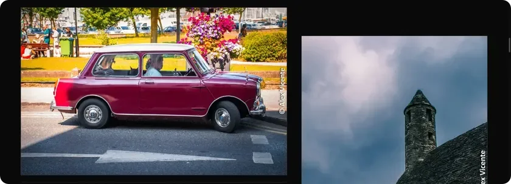

<h1>
<picture>
  <source media="(prefers-color-scheme: dark)" srcset="assets/banner-dark.svg">
  
</picture>
</h1>

  
  
  

**Valencia, España · Presencial, híbrido o remoto**

Desarrollador web junior con base en React/Next.js y PHP/Laravel. En mis prácticas en Burguet Sistemas desarrollé, en equipo, una aplicación de escritorio de gestión de parking (React, Electron) y evolucioné una intranet corporativa (React, PHP, MySQL). Fuera del trabajo construyo proyectos full-stack con código público, uso la IA como herramienta de desarrollo y valido el código con pruebas. Busco incorporarme a un equipo de producto en Valencia o en remoto.

## Proyectos seleccionados

### LumaFlow Studio

**Un CRM para estudios de foto y vídeo.** Centraliza clientes, agenda, presupuestos y entregas. Puedes recorrer el flujo del estudio sin registrarte.

**[Explorar la demo de LumaFlow](https://lumaflow.aleviclop.dev/demo)** · [Ver código](https://github.com/AVL05/lumaflow-studio)

Laravel · React · MySQL · 56 tests de backend y 33 de frontend

### Distrito Gourmet y raw.vives

  
  

**Distrito Gourmet.** Mi proyecto de fin de ciclo de DAW reúne carta digital, reservas, pedidos y gestión del restaurante. React · Laravel · MySQL · Tailwind CSS · Docker. [Demo](https://distrito-gourmet.aleviclop.dev/) · [Código](https://github.com/AVL05/distrito-gourmet)

**raw.vives.** Archivo fotográfico bilingüe con fotografía propia, composición editorial e interacción. Next.js · Tailwind CSS · GSAP. [Archivo](https://rawvives.aleviclop.dev/es/archive) · [Código](https://github.com/AVL05/alexgallery)

**Más proyectos:** [Premium Frontend Director](https://github.com/AVL05/premium-frontend-director), skill de código abierto (MIT) para diseñar interfaces con agentes de IA · [ECHO: The Awakening](https://github.com/AVL05/echo-the-awakening), experiencia de ciencia ficción jugable en el navegador.

## Stack

   <strong>Frontend</strong> · React, Next.js, JavaScript, Tailwind CSS, GSAP 
   <strong>Backend</strong> · PHP, Laravel, MySQL, APIs REST 
   <strong>Calidad</strong> · Vitest, PHPUnit, Playwright, ESLint 
   <strong>Entrega</strong> · Git, Docker, Vercel, Cloudflare, GitHub Actions

## Formación

Técnico Superior en DAW · Técnico en SMR · Curso AWS Academy Cloud Foundations (2025–2026)
