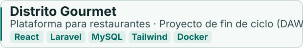
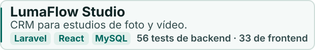
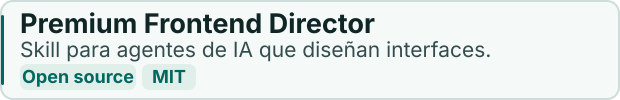
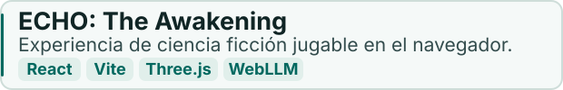

<h1>
  <picture>
    <source media="(prefers-color-scheme: dark)" srcset="assets/banner-dark.svg">
    
  </picture>
</h1>

Valencia, España · presencial, híbrido o remoto.

Desarrollador web junior con base en React/Next.js y PHP/Laravel. En mis prácticas en Burguet Sistemas desarrollé, en equipo, una aplicación de escritorio de gestión de parking (React, Electron) y evolucioné una intranet corporativa (React, PHP, MySQL). Fuera del trabajo construyo proyectos full-stack con código público, uso la IA como herramienta de desarrollo y valido el código con pruebas. Busco incorporarme a un equipo de producto en Valencia o en remoto.

  
  
  

## Proyectos

  <picture>
    <source media="(prefers-color-scheme: dark)" srcset="assets/project-distrito-gourmet-dark.svg">
    
  </picture>
   
  <a href="https://github.com/AVL05/distrito-gourmet" title="Repo · Distrito Gourmet" aria-label="Repo · Distrito Gourmet">Repo</a>
  &nbsp;·&nbsp; <a href="https://distrito.aleviclop.dev" title="Demo · Distrito Gourmet" aria-label="Demo · Distrito Gourmet">Demo</a>

  <picture>
    <source media="(prefers-color-scheme: dark)" srcset="assets/project-lumaflow-studio-dark.svg">
    
  </picture>
   
  <a href="https://github.com/AVL05/lumaflow-studio" title="Repo · LumaFlow Studio" aria-label="Repo · LumaFlow Studio">Repo</a>

  <picture>
    <source media="(prefers-color-scheme: dark)" srcset="assets/project-raw-vives-dark.svg">
    
  </picture>
   
  <a href="https://github.com/AVL05/alexgallery" title="Repo · raw.vives" aria-label="Repo · raw.vives">Repo</a>
  &nbsp;·&nbsp; <a href="https://rawvives.aleviclop.dev" title="Web · raw.vives" aria-label="Web · raw.vives">Web</a>

  <picture>
    <source media="(prefers-color-scheme: dark)" srcset="assets/project-premium-frontend-director-dark.svg">
    
  </picture>
   
  <a href="https://github.com/AVL05/premium-frontend-director" title="Repo · Premium Frontend Director" aria-label="Repo · Premium Frontend Director">Repo</a>

  <picture>
    <source media="(prefers-color-scheme: dark)" srcset="assets/project-echo-dark.svg">
    
  </picture>
   
  <a href="https://github.com/AVL05/echo-the-awakening" title="Repo · ECHO: The Awakening" aria-label="Repo · ECHO: The Awakening">Repo</a>

## Stack

   <strong>Frontend</strong> · React, Next.js, JavaScript, Tailwind CSS, GSAP 
   <strong>Backend</strong> · PHP, Laravel, MySQL, APIs REST 
   <strong>Calidad</strong> · Vitest, PHPUnit, Playwright, ESLint 
   <strong>Entrega</strong> · Git, Docker, Vercel, Cloudflare, GitHub Actions

## Formación

- Técnico Superior en DAW
- Técnico en SMR
- Curso AWS Academy Cloud Foundations (2025–2026)
