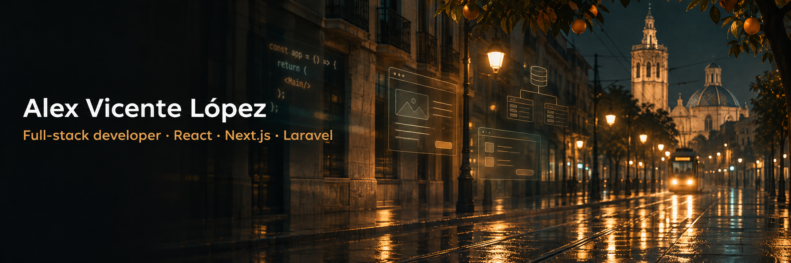
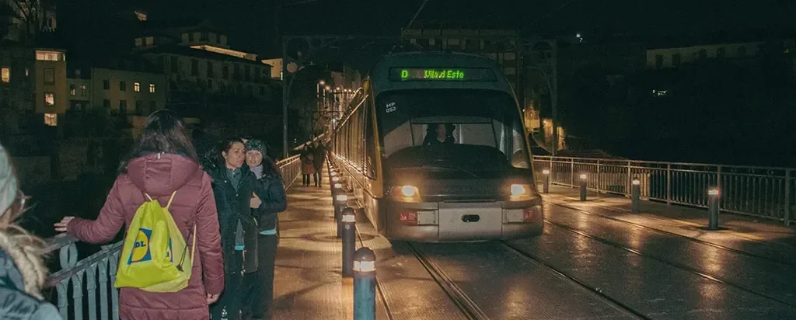

<div align="center">

<a href="https://www.aleviclop.dev/">
  
</a>

<br />

<a href="https://www.aleviclop.dev/">
  
</a>

<br /><br />

<a href="https://www.aleviclop.dev/"></a>
<a href="https://www.aleviclop.dev/cv/CV_Alex_Vicente_Lopez.pdf?v=2026-09"></a>
<a href="https://www.linkedin.com/in/aleviclop"></a>
<a href="mailto:alexviclop@gmail.com"></a>

<br />


</div>

<br />

## 👋 Hola, soy Alex

Me gusta construir aplicaciones **de principio a fin**: diseñar la interfaz, conectarla con una API y modelar los datos que necesita. En mis prácticas trabajé en una **intranet** y en una **aplicación de escritorio**; en mis proyectos personales mezclo desarrollo, diseño de interfaces y fotografía.

```js
const alex = {
  rol:        "Full-stack developer (junior)",
  frontend:   ["React", "Next.js", "TypeScript", "Tailwind CSS", "GSAP"],
  backend:    ["PHP", "Laravel", "APIs REST", "MySQL"],
  ahoraMismo: "Buscando mi primer equipo de producto 🚀",
  fueraDelCódigo: "📷 raw.vives — fotografía urbana y de viaje",
};
```

<br />

## 🚀 Proyectos destacados

<table>
  <tr>
    <td width="33%" valign="top">
      <h3 align="center">📸<br />LumaFlow Studio</h3>
      <p align="center"><sub><b>GESTIÓN PARA ESTUDIOS DE FOTO Y VÍDEO</b></sub></p>
      <p>PWA que reúne clientes, sesiones, presupuestos, facturas y galerías privadas. Acceso a datos por usuario y un <b>asistente con IA local</b> bajo demanda.</p>
      <p align="center">
        
        
        
        
      </p>
      <p align="center">
        <a href="https://lumaflow.aleviclop.dev/demo"><b>▶ Probar la demo</b></a><br />
        <sub><a href="https://www.aleviclop.dev/proyectos/lumaflow-studio">Caso de estudio</a> · <a href="https://github.com/AVL05/lumaflow-studio">Código</a></sub>
      </p>
    </td>
    <td width="33%" valign="top">
      <h3 align="center">🍽️<br />Distrito Gourmet</h3>
      <p align="center"><sub><b>PROYECTO DE FIN DE CICLO</b></sub></p>
      <p>Carta, carrito y reservas para el cliente, conectados con los paneles que usa el personal para gestionar el restaurante. <b>Permisos según el rol</b> de cada usuario.</p>
      <p align="center">
        
        
        
        
      </p>
      <p align="center">
        <a href="https://distrito-gourmet.aleviclop.dev/"><b>▶ Ver la aplicación</b></a><br />
        <sub><a href="https://www.aleviclop.dev/proyectos/distrito-gourmet">Caso de estudio</a> · <a href="https://github.com/AVL05/distrito-gourmet">Código</a></sub>
      </p>
    </td>
    <td width="33%" valign="top">
      <h3 align="center">🎞️<br />raw.vives</h3>
      <p align="center"><sub><b>ARCHIVO FOTOGRÁFICO BILINGÜE</b></sub></p>
      <p>Mis fotografías con series, filtros y fichas en español e inglés. Generación estática, <b>navegación por teclado</b> y SEO localizado.</p>
      <p align="center">
        
        
        
      </p>
      <p align="center">
        <a href="https://rawvives.aleviclop.dev/es/archive"><b>▶ Explorar el archivo</b></a><br />
        <sub><a href="https://www.aleviclop.dev/proyectos/raw-vives">Caso de estudio</a> · <a href="https://github.com/AVL05/alexgallery">Código</a></sub>
      </p>
    </td>
  </tr>
</table>

<p align="center">
  <sub>Más proyectos y las decisiones detrás de cada uno en <a href="https://www.aleviclop.dev/#projects"><b>aleviclop.dev</b></a></sub>
</p>

<br />

## 🛠️ Stack

<p align="center">
  <a href="https://skillicons.dev">
    
    <br />
    
  </a>
</p>

| | |
|---|---|
| 🎨 **Frontend** | React, Next.js, JavaScript, TypeScript, Tailwind CSS y GSAP. Cuido la accesibilidad y el diseño responsive. |
| ⚙️ **Backend y datos** | PHP, Laravel, APIs REST y MySQL. Modelos relacionales y permisos de acceso. |
| 🚢 **Pruebas y despliegue** | Git, Docker, CI/CD, Vercel y Cloudflare. Uso la IA como apoyo y valido el código con revisión y pruebas. |

<br />

## 💼 Experiencia

> **Burguet Sistemas SL** · Desarrollo de aplicaciones web en prácticas  
> <sub>feb. – may. 2026</sub>
>
> Desarrollé en equipo una **aplicación de gestión de parking** en React y Electron, con módulos de cobros, caja y turnos. También añadí funcionalidades a una **intranet** en React, PHP y MySQL, diseñé tablas y resolví incidencias. Git y Bitbucket para coordinar el trabajo.

> **Ajuntament de Carlet** · Soporte informático en prácticas  
> <sub>mar. – jun. 2024</sub>
>
> Instalé y mantuve equipos, redes y cableado, y di soporte a usuarios.

<br />

## 🎓 Formación e idiomas

- 🎓 **Desarrollo de Aplicaciones Web (DAW)** · IES Serra Perenxisa · 2024–2026
- 🖧 **Sistemas Microinformáticos y Redes (SMR)** · Enseñanzas Profesionales Sorolla · 2022–2024
- ☁️ **AWS Academy Cloud Foundations** · 2025–2026
- 🗣️ Español y valenciano nativos · Inglés B1 (EF SET)

<br />

## 📷 Cuando no programo, fotografío

<a href="https://rawvives.aleviclop.dev/es/photo/21">
  
</a>

<p align="center">
  <sub><i>«Última parada: la noche»</i> · Oporto, 2024 · Más en <a href="https://rawvives.aleviclop.dev/es/archive"><b>raw.vives</b></a></sub>
</p>

<br />

<div align="center">

**¿Tienes un proyecto o una vacante en la que encaje?**  
[Escríbeme](mailto:alexviclop@gmail.com) y lo hablamos ☕

</div>
